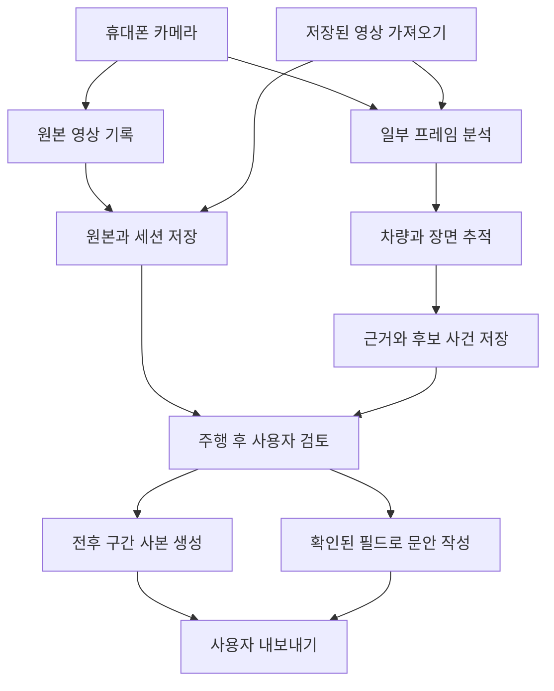

# RoadWitness 기술 구조

Android 앱에서 원본을 기록하고, 별도의 분석 흐름에서 후보 사건을 생성합니다. 모델이 늦어지더라도 녹화 흐름이 대기하지 않도록 작업과 저장을 분리합니다. 다음 구조는 구현 전 제안이며, 1~2주차 실기기 결과로 구체화합니다.

## 기술 선택

| 영역 | 우선 제안 | 선택 목적과 검증 항목 |
| --- | --- | --- |
| 앱 | Kotlin, Jetpack Compose | 촬영·저장·권한과 화면을 Android에서 함께 제어 |
| 촬영 | CameraX | 녹화와 프레임 분석 병행, 기기별 해상도 조합 검증 |
| 재생·편집 | Media3 ExoPlayer, Transformer | 구간 재생, 잘라낸 사본 내보내기, 경계 프레임 확인 |
| 모델 실행 | LiteRT | 차량·번호판·차선 모델의 기기 내 추론 실험 |
| OCR | ML Kit 한국어 텍스트 인식 | 번호판 영역을 읽되 판독 불가와 사용자 수정 지원 |
| 저장 | Room과 앱 전용 파일 저장소 | 세션·사건 메타데이터와 영상 파일 관리 |
| 요약 | 필드 기반 문장 템플릿 | 근거가 있는 정보만 문안에 반영 |
| 공유 | Android 파일 공유 흐름 | 사용자 선택으로 영상과 요약문 전달 |

CameraX는 미리보기·녹화·분석을 함께 구성할 수 있지만 기기와 해상도에 따라 제약과 처리 부담이 있습니다. [CameraX 구조](https://developer.android.com/media/camera/camerax/architecture)

분석에 `STRATEGY_KEEP_ONLY_LATEST`를 적용하면 처리하지 못한 분석 프레임을 버리고 최신 프레임을 사용하도록 구성할 수 있습니다. 분석 프레임 드롭과 증거 영상의 누락은 서로 구분해 측정합니다. [CameraX 영상 분석](https://developer.android.com/media/camera/camerax/analyze)

Media3 Transformer는 구간 자르기와 영상 변환을 지원합니다. 키프레임과 재인코딩 조건을 시험해 사용자가 지정한 구간과 최종 결과를 대조합니다. [Media3 변환](https://developer.android.com/media/media3/transformer/transformations)

ML Kit는 Android에서 한국어 텍스트 인식 모델을 제공하지만 한국 차량 번호판 인식률을 보장하는 제품은 아닙니다. 번호판 영역 검출과 문자 인식을 따로 평가하고, 오프라인 사용을 위해 모델을 앱에 포함하는 구성을 우선 검토합니다. [ML Kit 한국어 OCR](https://developers.google.com/ml-kit/vision/text-recognition/v2/android)

LiteRT는 기기 내 모델 실행 도구입니다. 위반 장면을 이해하는 모델과 한국 번호판·차선 자료는 별도로 확보해야 합니다. [LiteRT 공식 안내](https://developers.google.com/edge/litert)

라이브러리 버전은 앱 초기화 시 안정 버전을 선택해 고정합니다. 최소 지원 OS는 선택한 라이브러리와 지원 기기의 요구사항을 함께 확인해 정합니다.

## 처리 흐름

## 영상 보관과 사건 구간

첫 실험은 연속 녹화 파일과 사건 시간 표시로 시작합니다. 녹화를 반복 중지·재시작하는 것만으로 공백 없는 순환 버퍼를 보장하지 않습니다. 세그먼트 간 공백과 파일 확정을 측정하고, 필요하면 낮은 수준의 녹화 방식을 별도 검토합니다.

공백 문제를 해결한 이후에는 저장 공간 한도 안에서 임시 파일을 순환 보관합니다. 사건 발생 시 기본값 예시인 전 10초·후 10초를 보호 대상으로 표시하고, 인접 사건은 겹치는 영상 파일을 공유합니다. 이 길이는 사용자 경험용 제안이며 신고 요건에 맞춰 조정합니다.

사건에 연결된 구간은 내보내기와 사용자 보관 결정을 마칠 때까지 순환 삭제 대상에서 제외합니다. 원본의 보호 구간, 내보낸 사본, 위치 표본을 연결하는 인덱스를 두며 저장 공간 부족으로 구간이 잘리면 그 사실을 표시합니다.

내보내기는 임시 경로에서 완료한 다음 최종 파일로 전환합니다. 앱 종료 후 미완성 작업을 다시 실행하거나 정리할 수 있게 상태를 보관하고, 출력 파일 재생·길이 확인 후 성공으로 표시합니다.

## 시간축과 위치

각 세션은 촬영 시작의 UTC 시각과 기기의 단조 증가 시계 기준점을 보관합니다. 인코딩 영상의 재생 시간축, 분석 프레임 시각과 위치 표본의 시각을 같은 세션 기준으로 매핑하고 그 관계를 검증합니다. 기기 시계가 바뀌어도 사건 구간이 잘못 이동하지 않도록 합니다.

가져온 파일은 원본 재생 시간축을 기준으로 사건을 지정합니다. 촬영 시각이 검증되지 않으면 `captured_at`을 비워 둡니다. 파일 생성·수정 시간과 촬영 시간은 서로 다른 출처입니다.

위치 표본은 시각, 위도·경도, 정확도, 출처를 함께 보관합니다. 사건 시점과 충분히 가까운 표본을 찾지 못하면 미확인으로 남기고, 사용자 수정값에는 수정 출처와 확인 상태를 붙입니다.

## 주요 데이터

| 객체 | 주요 필드 | 목적 |
| --- | --- | --- |
| DriveSession | ID, 입력 종류, 시작 UTC, 시계 기준점, 녹화 설정 | 한 번의 주행 또는 가져오기 묶음 |
| SourceVideo | ID, 파일 참조, 길이, SHA256, 세션 시간 매핑 | 원본 보존과 영상 구간 연결 |
| LocationSample | 세션 ID, 상대 시각, 좌표, 정확도, 출처 | 사건 위치의 근거 |
| Track | ID, 세션 ID, 상대 시각별 차량 영역 | 같은 차량의 이동 추적 |
| CandidateEvent | 유형, 구간, 차량 ID, 관측 근거, 모델·규칙 버전 | 위반 의심 후보 |
| PlateObservation | 프레임 시각, OCR 제안, 읽기 가능 여부, 사용자 확인값 | 차량 식별 제안과 최종 확인 구분 |
| EvidenceClip | 원본 ID와 구간 목록, 출력 파일, 해시, 작업 상태 | 원본에서 만들어진 사본 |
| ReportDraft | 검토한 필드, 문안, 검토·내보내기 상태 | 신고 준비 결과 |

예시는 [합성 이벤트 JSON](../examples/sample-event.json)에 있습니다. 초기 예시는 운영 스키마가 아니라 값의 출처와 확인 상태를 검토하기 위한 자료입니다.

## 사건과 접수 상태

사건의 검토 상태는 `candidate → reviewing → ready` 또는 `dismissed`입니다. `ready` 사건이 내보내기를 마치면 `exported`를 기록합니다. 필수 근거가 없으면 검토 필요 상태를 유지합니다.

접수 상태는 별도 필드로 `unknown`, `user_confirmed_submitted`, `officially_confirmed_submitted`를 사용합니다. 공유 화면을 열거나 파일을 내보낸 것만으로 신고 완료로 처리하지 않습니다.

## 장애 대응

- 분석 과부하: 분석 빈도를 줄이고 녹화를 계속하며 저하 상태를 기록합니다.
- 발열: 기기 상태에 따라 분석·촬영 품질을 조절하거나 종료하며 사건 파일을 먼저 확정합니다.
- 공간 부족: 보호되지 않은 임시 자료부터 정리하고, 보호 구간을 지킬 수 없으면 명시적으로 알립니다.
- 권한 거부: GPS 없는 기록과 영상 가져오기를 제공하고 결측값을 표시합니다.
- 앱 종료: 원본과 작업 인덱스를 대조해 미완성 내보내기와 임시 파일을 복구·정리합니다.
- 화면 잠금·다른 앱·전화: Android 카메라·서비스 동작을 실기기에서 시험하고 검증된 촬영 모드만 지원합니다.

## 후속 확장 경계

영상 입력, 사건 후보 생성, 번호판 읽기, 구간 편집, 요약문 생성을 인터페이스로 분리합니다. 서버나 iOS를 추가해도 원본 구간·출처·검토 상태를 유지합니다. 첫 구현은 Android 한 앱으로 시작하며 데이터가 쌓이기 전에 서버 운영과 복잡한 다중 앱 구조를 만들지 않습니다.
